# Lantern Offline Survival Resource

Lantern is an offline library for a household. It's a Raspberry Pi 5 with an NVMe drive that broadcasts its own Wi-Fi network, called LIBRARY (no password). Anyone in the house can join it with a phone or laptop, open http://library.lan, and get medical references, Wikipedia, repair manuals, maps, audiobooks for the kids and a few thousand other books and films. Once the box is built, none of it needs the internet.

The reference build holds 1.2 TB in 379,624 files. The two largest items are Project Gutenberg (221 GB) and the full English Wikipedia (127 GB).

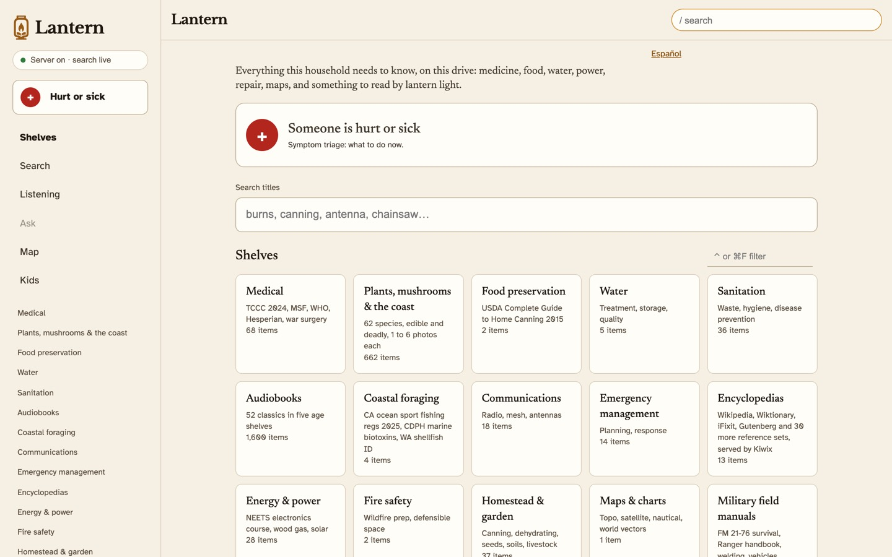

## What's on it

The front page leads with a red "Someone is hurt or sick" button. It opens 28 triage cards (severe bleeding, burns, choking, stroke, snakebite and so on), in English and Spanish. Each card has a NOW section with what to do first and a DEEPER section with what to read once the person is stable. Every NOW step cites a page in a medical book on the shelf, usually Where There Is No Doctor or the TCCC guidelines, and the build refuses to finish if a cited page goes missing or no longer says what the card says. Lantern's own pages never give drug doses; for doses, use a printed drug guide.

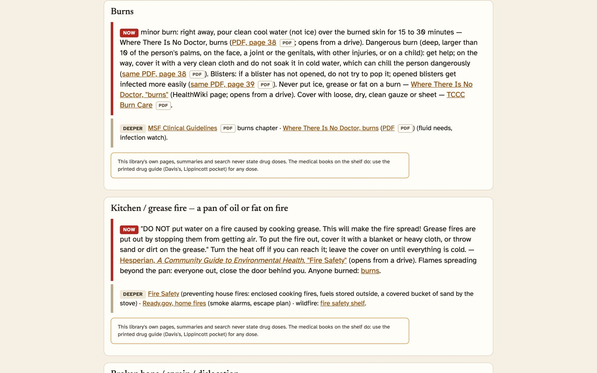

Search covers titles and the text inside the PDFs. Title search works even when the library is opened straight from a drive with no server running. Full-text search uses Pagefind indexes that are built when the library is sealed.

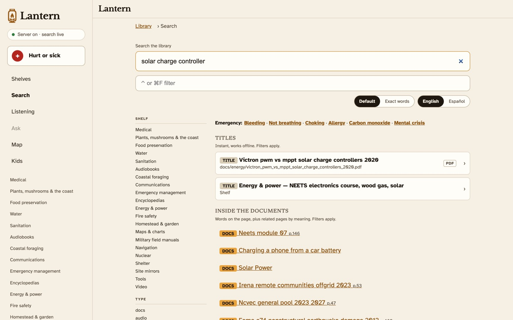

The reference build also has 38 Kiwix archives served by kiwix-serve: Wikipedia, WikiMed, Wiktionary, Wikivoyage, Wikibooks, eight Stack Exchange sites, iFixit, Appropedia, Gutenberg and others. Public builds have 37, because one archive was a crawl of a copyrighted website and was dropped.

The document shelves cover medicine, water, sanitation, food preservation, energy, communications, shelter, navigation and more. Each PDF gets a cover rendered from its first page and opens in a built-in reader.

The plant section has 86 plants, mushrooms and coastal species with photos, each labeled edible or deadly. When an edible plant has a dangerous lookalike, the two are shown side by side.

The map is an offline street map of the whole planet (Protomaps, 138 GB) with hospitals marked. It can't show where you are, and the page says so. For turn-by-turn directions, the box also has Organic Maps and OsmAnd files to load onto Android phones.

For listening and watching, there are 52 LibriVox audiobooks sorted by age, 20 Prelinger films on trades and farming, 1,499 Khan Academy videos and five Kolibri lesson channels.

A HISTORICAL section holds 4,752 Survivor Library scans of pre-1950 books and some older medical texts. It sits behind a warning page because a lot of the advice in those books is out of date.

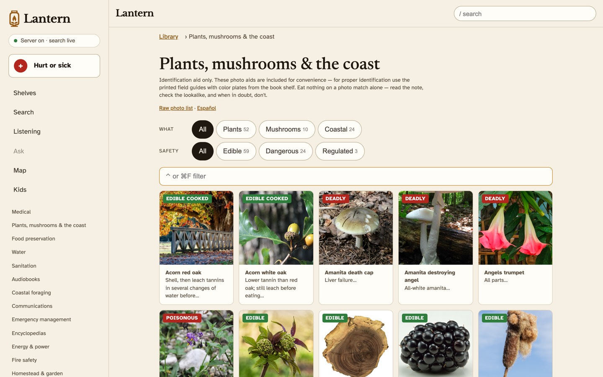

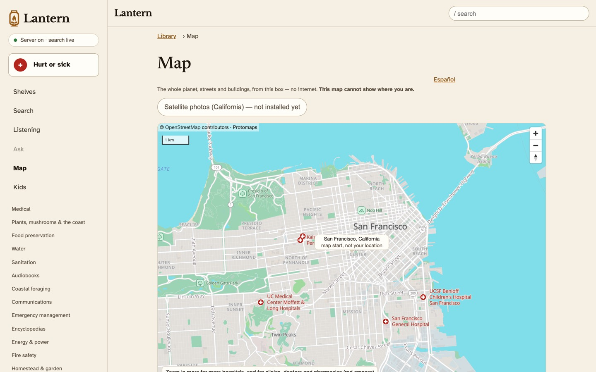

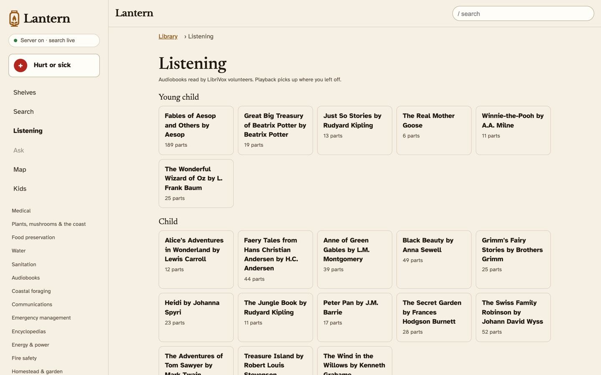

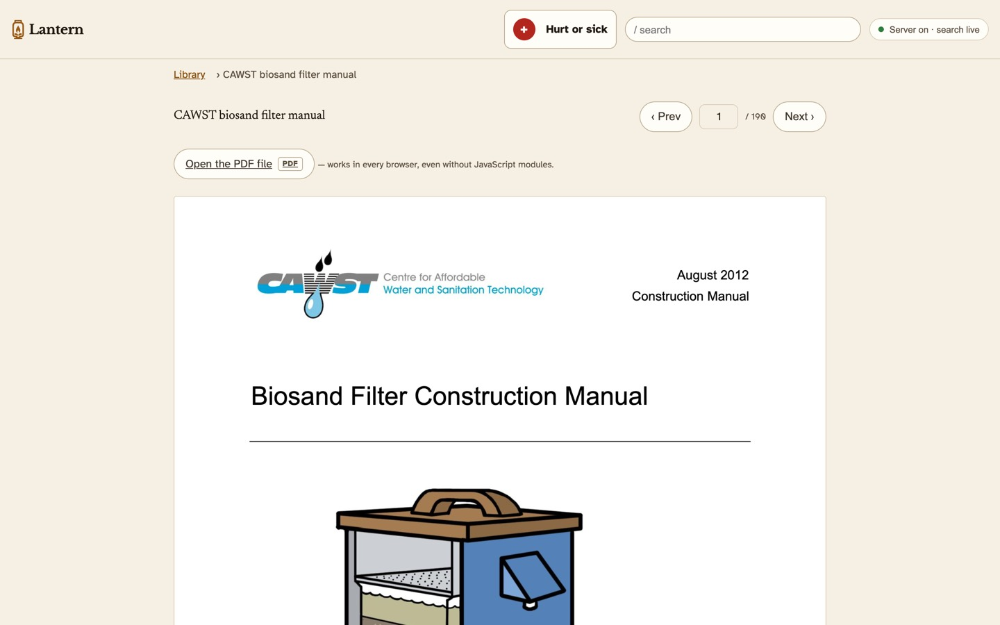

The Ask page works without any AI. It shows the matching emergency cards and a list of pages from the library's books. If a laptop on the LIBRARY network is running llamafile with Llama 3.2 3B or Llama 3.1 8B, the Ask page uses it to put the most useful pages first. The model writes nothing the reader sees, and it runs on the laptop because the Pi is too small to run a chat model well.

On a phone, the tabs move to the bottom and the "Hurt or sick" button sits in the middle of them. The site follows the phone's light or dark setting.

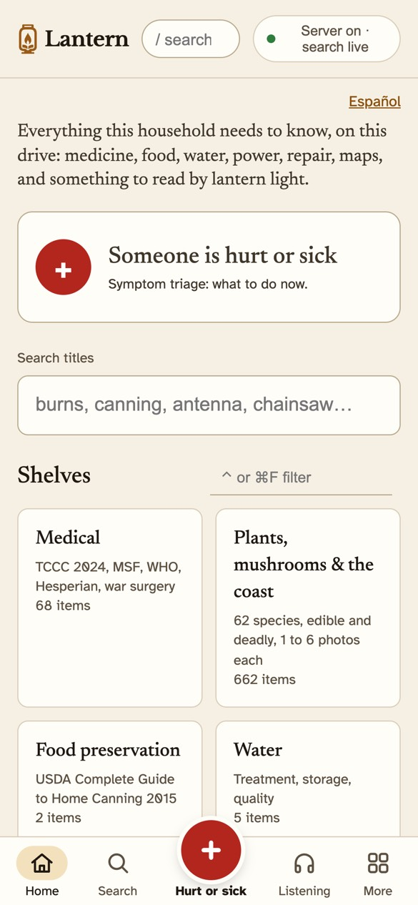
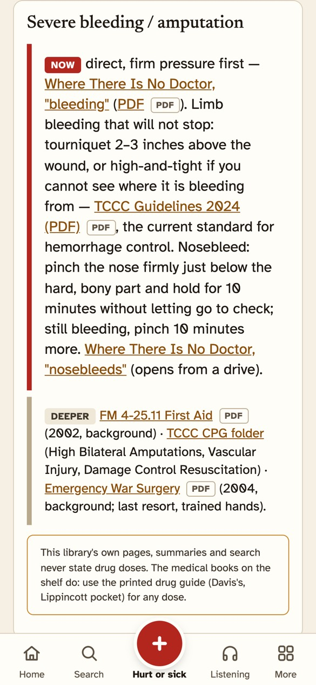
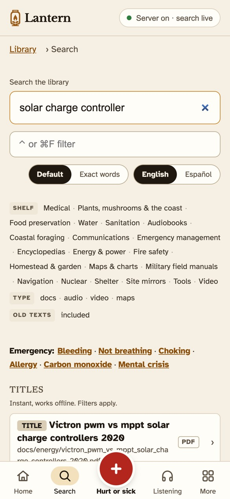

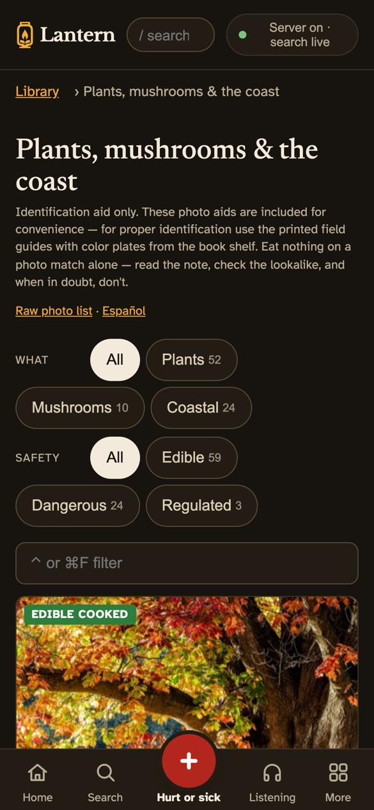
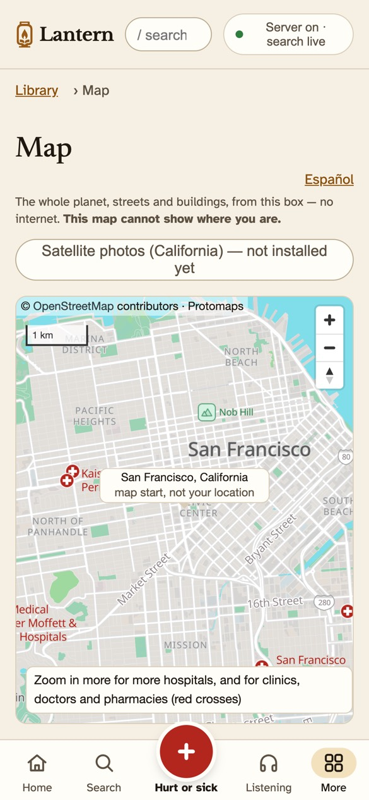
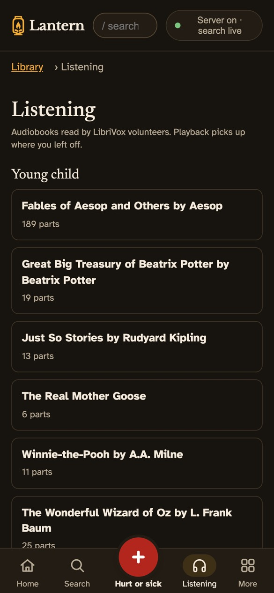

The screenshots come from a test build of this repository with a 33 GB part of the library, with the map set to start in San Francisco.

## Building your own

This repository has the code and none of the content. Whoever builds a box downloads every book, archive, map and model, under each item's own license. The third-party JavaScript, fonts and tools (pdf.js, MapLibre, Pagefind, kiwix-tools and a few others) are left out of git too; `python3 fetch/fetch_all.py` downloads them and checks each one against a pinned sha256.

[BUILDING.md](BUILDING.md) walks through a build from a fresh checkout. It's written for someone following along with an AI coding assistant open. You can build the whole 1.2 TB library or only the shelves you want, and `sources.json` lists every content folder with the script that downloads it and its license.

The reference box runs boot image 1.0.5 and library release 2026.11.08. On 2026-11-10, a partial library built from a fresh checkout of this repository sealed with all link checks and 117 unit tests passing. The boot image build is pinned to the pi-gen commit that made 1.0.5, but nobody has rebuilt and booted an image from this repository yet.

## Home region

The map opens on Redwood City, California, and the search server's sunrise and sunset tool uses it as its default location. To change it, edit `homeRegion` (a name, a latitude and a longitude) in `library/_app/config.json` before you build. `library/map.html` has the same coordinates as a fallback in case the config file can't be read, and the tests in `server/` also use Redwood City.

## Repository layout

| Folder | Contents |
|---|---|
| `library/` | The website the box serves. The build adds the content folders, the downloaded third-party files and the generated pages. |
| `build/` | Scripts that generate the site (shelves, triage pages, search indexes, text layer, covers) and seal it (`b5_reseal.sh`, `seal_chain.sh`, `gen_version.sh`). |
| `deploy/` | Scripts that copy a sealed library to a Pi, check the box, upgrade it in place, sync a backup SSD and set up a new box (`new_box.sh`). |
| `image/` | The boot image: the pi-gen stage in `stage-lantern/`, the build and patch scripts and the Lima VM definition. |
| `server/` | The search server that runs on the box, the builders for its index and embeddings, and their unit tests. |
| `tests/` | Test tiers t0 to t9: file integrity, formats, serving, links, coverage, rendering, box checks and the catalog. |
| `fetch/` | `fetch_all.py` for the files in `sources.json`, and the content download scripts (Kiwix, archive.org, government sites, maps, Kolibri). |
| `data/` | Inputs the build reads: catalog data, the link table (`refs.json`), search synonyms, known gaps, test queries, the species notes and the library's own READMEs and notes (`library_notes/`). |
| `docs/` | The content plan (`MASTER_LIST.md`), notes on sources, the test plan, the search server design, the system guide and these screenshots. |

## Licenses

Copyright 2026 Eric Cheng. The code is under the Apache License 2.0 (see `LICENSE` and `NOTICE`). The third-party JavaScript, fonts and tools that the build downloads keep their own licenses (Apache-2.0, BSD-3-Clause, MIT, OFL-1.1 and GPL-3.0), and the build saves each license text next to the files it covers. The screenshots include Wikipedia text, Wikimedia Commons photos and OpenStreetMap data, which stay under their own licenses.

Please check the content licenses yourself before you build a box, give one away or sell one. The license lines in `sources.json` and `library/LICENSES.md` were written down in 2026 as a starting point, and they aren't legal advice. Not every one was checked against the source's own terms (those are marked "verify"), terms change, and what you're allowed to do with a copy depends on where you live and what you do with it. The content comes under many licenses: public domain, CC BY, CC BY-SA, noncommercial licenses (CC BY-NC-SA, CC BY-NC-ND), ODbL, and websites that keep their copyright and allow a personal copy at most. Each builder downloads the content and is responsible for following its terms.
